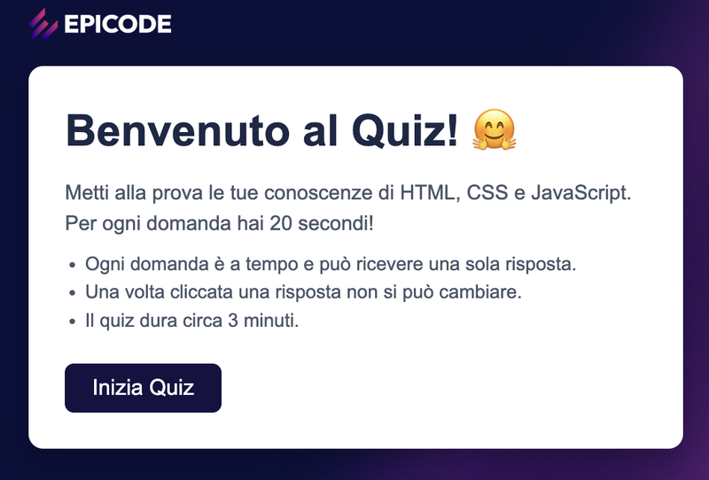
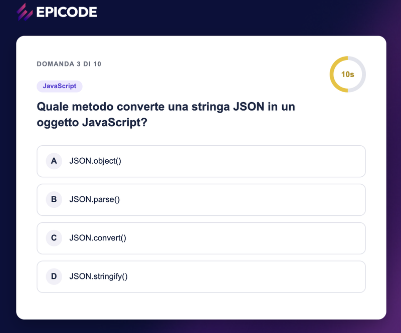
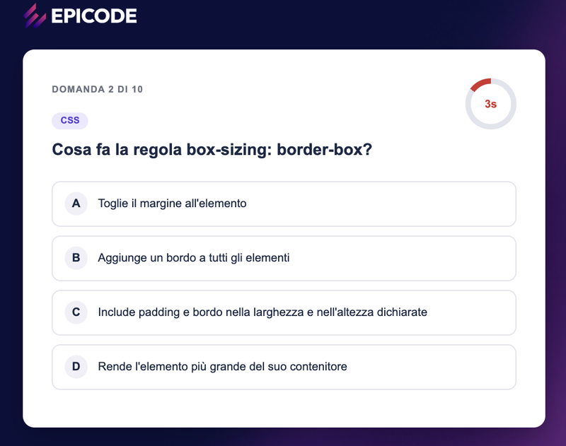
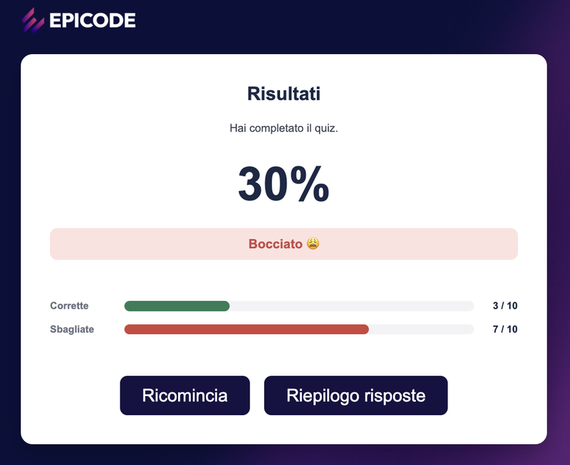
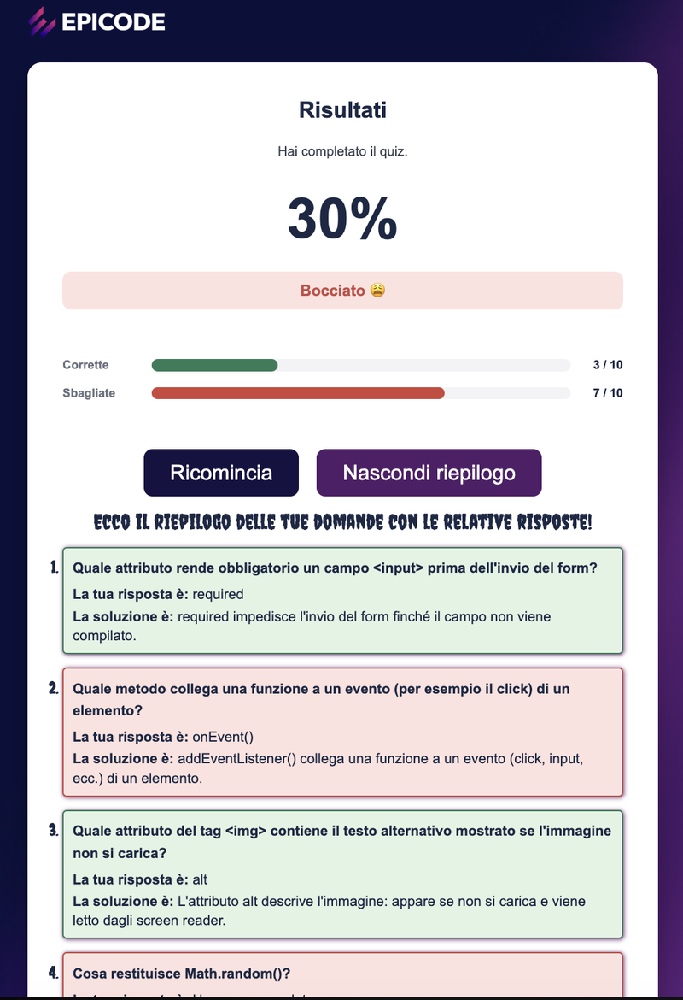

# Quiz Epicode – Team 4

Un quiz a tempo in JavaScript puro: rispondi alle domande prima che scada il timer e scopri se sei promosso.

> **Stato del progetto:** completato e pronto per la consegna. Il quiz funziona dall'inizio ai risultati; i limiti noti sono elencati in [Limiti noti](#limiti-noti).

**Build Week 1 · Master Epicode · Team 4**

[Cosa fa](#cosa-fa) · [Come avviarlo](#come-avviarlo) · [Architettura](#architettura) · [Il team](#il-team)

---

## Indice

- [Cosa fa](#cosa-fa)
- [Anteprima](#anteprima)
- [Tecnologie](#tecnologie)
- [Come avviarlo](#come-avviarlo)
- [Struttura del progetto](#struttura-del-progetto)
- [Architettura](#architettura)
- [Come funziona](#come-funziona)
- [Convenzioni di codice](#convenzioni-di-codice)
- [Il team](#il-team)
- [Flusso di lavoro Git](#flusso-di-lavoro-git)
- [Personalizzazioni facoltative](#personalizzazioni-facoltative)
- [Limiti noti](#limiti-noti)
- [Crediti](#crediti)

---

## Cosa fa

Versione semplificata del quiz di Epicode. L'app ha tre schermate, che si susseguono senza mai cambiare pagina:

1. **Benvenuto**: presenta il quiz, ricorda le regole e ha il pulsante **Inizia Quiz**.
2. **Quiz**: mostra una domanda alla volta, con quattro risposte possibili.
3. **Risultati**: mostra l'esito finale, permette di rivedere le risposte date e di ricominciare.

Funzioni principali:

- **10 domande su HTML, CSS e JavaScript**, pescate da un archivio di 20 e mostrate in ordine casuale, con le risposte mescolate a ogni partita.
- **Timer rotondo** a conto alla rovescia su ogni domanda (20 secondi), a destra, con il numero al centro dell'anello. L'anello è verde, diventa giallo sotto i 10 secondi e rosso sotto i 5; a zero le risposte si bloccano, viene evidenziata quella giusta e il quiz passa alla domanda dopo.
- **Feedback immediato**: la risposta corretta diventa verde, quella sbagliata scelta diventa rossa e la giusta viene mostrata comunque.
- **Contatore di progresso** ("DOMANDA 3 DI 10").
- **Risultato finale**: percentuale di risposte corrette, esito **Promosso** (almeno 6 risposte giuste su 10) o **Bocciato**, numero di corrette e sbagliate, due barre colorate su tre colonne (etichetta, barra, conteggio).
- **Riepilogo risposte**: il pulsante nella pagina dei risultati apre l'elenco delle 10 domande con la risposta data e la soluzione, su sfondo verde se corretta e rosso se sbagliata; se il tempo è scaduto la risposta risulta «Non hai risposto nel tempo dato». Lo stesso pulsante lo nasconde di nuovo.
- **Ricomincia**: ricarica la pagina e riporta alla schermata iniziale, con domande rimescolate e punteggio azzerato.

## Anteprima

Le tre schermate del quiz, dalla pagina iniziale ai risultati con il riepilogo delle risposte.

| Pagina iniziale | Domanda, timer giallo (10 s) |
|---|---|
|  |  |

| Timer rosso (ultimi 5 s) | Risultati |
|---|---|
|  |  |

| Riepilogo delle risposte (con il font Creepster) |
|---|
|  |

## Tecnologie

| Tecnologia | Uso |
|---|---|
| HTML5 | Pagina unica `index.html` con le tre `<section>` delle schermate |
| CSS3 | Stile, hover sugli elementi cliccabili, colori coerenti con il brand Epicode, font Creepster (Google Fonts) per il riepilogo |
| JavaScript (vanilla) | Logica del quiz e costruzione delle schermate, senza framework |

Scelte tecniche:

- **SPA**: l'URL resta sempre `index.html`; le schermate sono viste dentro la stessa pagina, non pagine separate.
- **Niente `localStorage`**: lo stato vive solo in memoria. Ricaricando la pagina si riparte da capo.
- **Nessuna build**: non servono `npm`, bundler o dipendenze. L'unica risorsa esterna è il font Creepster, caricato da Google Fonts con `@import` in `style.css`: senza connessione il riepilogo usa il font di sistema (`system-ui`).
- **Un solo file JavaScript**: durante il lavoro il codice era diviso in più file per dividersi i compiti; alla fine tutto è stato unito in `script.js`.

## Come avviarlo

1. Clona la repo:

   ```bash
   git clone https://github.com/Ilbollit0/Team-4-progetto-buildweek-1-.git
   cd Team-4-progetto-buildweek-1-
   ```

2. Apri `index.html` con l'estensione **Live Server** di VS Code (la porta è impostata a `5501` in `.vscode/settings.json`, quindi `http://127.0.0.1:5501`), oppure apri il file direttamente nel browser.

## Struttura del progetto

```text
.
├── index.html                 pagina unica con le tre sezioni delle schermate
├── ISTRUZIONI PROGETTO.md     brief Epicode + decisioni del team
├── README.md
└── assets/
    ├── bg.jpg                 sfondo
    ├── epicode-logo.png       logo
    ├── EPICODE-pitto-color (1).png   icona della scheda (favicon)
    ├── css/
    │   └── style.css          stile
    ├── screenshots/           immagini per l'anteprima del README
    └── js/
        └── script.js          tutta la logica del quiz
```

## Architettura

L'app segue il pattern **stato → render → eventi**:

1. **Stato**: variabili in memoria (`indiceDomanda`, `punteggio`, `tempoRestante`, `timerIntervallo`), l'elenco delle domande già mescolate (`domandeMischiate`) e le risposte date finora (`arrayRisposte`).
2. **Render**: le funzioni creano gli elementi con `document.createElement` e li inseriscono nella sezione giusta della pagina.
3. **Eventi**: i click (Inizia Quiz, risposte, Riepilogo risposte, Ricomincia) e lo scadere del timer aggiornano lo stato e richiamano il render con `addEventListener`.

In `index.html` le tre schermate sono tre `<section>` con la classe `schermata`, già presenti nella pagina:

```html
<section id="paginaIniziale" class="schermata"></section>
<section id="domande" class="schermata nascosto"></section>
<section id="paginaFinale" class="schermata nascosto"></section>
```

Il JavaScript riempie ogni sezione, e `mostraSchermataGiusta(id)` ne lascia visibile una sola, aggiungendo la classe `nascosto` (`display: none` nel CSS) a tutte le altre:

```js
function mostraSchermataGiusta(idSchermata) {
  const tutteLeSchermate = document.querySelectorAll('.schermata');
  tutteLeSchermate.forEach((schermata) => {
    schermata.classList.add('nascosto');
  });
  const schermataDaMostrare = document.getElementById(idSchermata);
  if (schermataDaMostrare) {
    schermataDaMostrare.classList.remove('nascosto');
  }
}
```

Flusso delle schermate:

```text
 paginaIniziale --(Inizia Quiz)--> domande --(10 finite)--> paginaFinale
       ^                                                          |
       |                                                          |
       +--------------(Ricomincia: ricarica la pagina)------------+
```

Funzioni principali di `script.js`:

| Funzione | Cosa fa | Chi l'ha scritta |
|---|---|---|
| `mostraSchermataGiusta(id)` | Mostra una schermata e nasconde le altre | Nicholas |
| `mostraBenvenuto()` | Costruisce la pagina iniziale e il pulsante Inizia Quiz | Manuel, Alessandro |
| `mescolaArray(array)` | Mescola un array (algoritmo di Fisher–Yates) | Nicholas |
| `caricaProssimaDomanda()` | Prende la domanda corrente, la disegna e fa partire il timer; finite le 10 passa ai risultati | Nicholas |
| `avviaTimer(durata, callback)` / `fermaTimer()` | Conto alla rovescia di una domanda | Nicholas |
| `gestisciTempoScaduto()` | Salva la domanda in `arrayRisposte` come non risposta, blocca i bottoni, mostra la risposta giusta e passa avanti | Nicholas |
| `renderQuiz()` | Costruisce la domanda con contatore, timer e risposte | Francesco, Manuel |
| `gestisciRisposta(bottone, risposta)` | Salva la risposta in `arrayRisposte`, la verifica e aggiorna il punteggio | Francesco, Manuel |
| `schermataFinale()` | Costruisce la pagina dei risultati, con il pulsante che mostra e nasconde il riepilogo | Giuseppe, Manuel |
| `mostraRisultati()` | Costruisce l'elenco del riepilogo a partire da `arrayRisposte` e lo restituisce | Manuel, Giuseppe |

## Come funziona

### Le domande

Le domande sono oggetti in un array (`quizDomande`, 20 domande: 6 di HTML, 6 di CSS, 8 di JavaScript):

```js
{
  id: 2,
  categoria: "HTML",
  domanda: "Quale attributo del tag  contiene il testo alternativo mostrato se l'immagine non si carica?",
  opzioni: ["alt", "src", "title", "href"],
  rispostaCorretta: "alt",
  tempo: 20,
  soluzione: "L'attributo alt descrive l'immagine: appare se non si carica e viene letto dagli screen reader.",
}
```

`tempo` è la durata del timer di quella domanda, in secondi: ogni domanda può averne uno diverso, oggi sono tutte a 20. `soluzione` è la spiegazione breve che compare nel riepilogo finale.

### Mescolare domande e risposte

All'avvio della pagina l'array viene copiato e mescolato; poi con `.map()` vengono mescolate anche le risposte di ogni domanda. L'array originale `quizDomande` non viene modificato: il quiz lavora su `domandeMischiate`.

```text
 quizDomande (20 domande, non si tocca)
        |
        v
 copia con [...quizDomande]
        |
        v
 mescolaArray: l'ordine delle domande cambia
        |
        v
 .map(): per ogni domanda
         mescolaArray(opzioni) --> le risposte cambiano ordine
        |
        v
 domandeMischiate
        |
        v
 si usano solo le prime 10 (indiceDomanda <= 9)
```

Il codice:

```js
function mescolaArray(array) {
  for (let i = array.length - 1; i > 0; i--) {
    const j = Math.floor(Math.random() * (i + 1));
    [array[i], array[j]] = [array[j], array[i]];
  }
  return array;
}

let domandeMischiate = mescolaArray([...quizDomande]);
domandeMischiate = domandeMischiate.map((domanda) => ({
  ...domanda,
  opzioni: mescolaArray([...domanda.opzioni]),
}));
```

### Timer

Ogni domanda ha la sua durata (`tempo`, oggi 20 secondi per tutte). Il timer è un anello fatto con un `conic-gradient`: `renderQuiz` costruisce `.timerRotondo` (l'anello) con dentro `.cerchioCentrale` (il cerchio bianco) e `.tempoRimasto` (il numero).

`avviaTimer` imposta `tempoRestante` e ogni secondo lo diminuisce, aggiornando il testo di `.tempoRimasto` e la parte grigia dell'anello senza ridisegnare la domanda. Il colore dipende dal tempo che resta: verde, giallo da 10 secondi in giù (classe `tempoGiallo`), rosso da 5 in giù (classe `tempoRosso`).

Cosa succede durante una domanda:

```text
 caricaProssimaDomanda
        |
        v
 renderQuiz  (disegna domanda, risposte e timer)
        |
        v
 avviaTimer(tempo)
        |
        v
 ogni secondo:  tempoRestante--
        |
        +--> aggiorna il numero e l'anello
        |
        +--> 10 s o meno:  giallo
        |
        +--> 5 s o meno:   rosso
        |
        v
 a 0 secondi
        |
        v
 fermaTimer
        |
        v
 gestisciTempoScaduto
        |
        +--> arrayRisposte.push: "Non hai risposto nel tempo dato"
        +--> blocca tutti i bottoni
        +--> la risposta giusta diventa verde
        |
        v
 dopo 1,5 secondi: indiceDomanda++  -->  caricaProssimaDomanda
```

Il codice di `avviaTimer`:

```js
function avviaTimer(durataInSecondi, tempoScaduto) {
  fermaTimer();
  tempoRestante = durataInSecondi;

  timerIntervallo = setInterval(() => {
    tempoRestante--;

    const elementoTimer = document.querySelector('.tempoRimasto');
    const cerchioTimer = document.querySelector('.timerRotondo');

    if (elementoTimer && cerchioTimer) {
      elementoTimer.textContent = `${tempoRestante}s`;

      let colore = '#2a7d57';
      if (tempoRestante <= 10) {
        colore = '#ecc115';
        elementoTimer.classList.add('tempoGiallo');
      }
      if (tempoRestante <= 5) {
        colore = '#d32f2f';
        elementoTimer.classList.remove('tempoGiallo');
        elementoTimer.classList.add('tempoRosso');
      }

      const percentualeGrigia = 100 - (tempoRestante / durataInSecondi) * 100;
      cerchioTimer.style.background = `conic-gradient(#e2e4ec ${percentualeGrigia}%, ${colore} 0)`;
    }

    if (tempoRestante <= 0) {
      fermaTimer();
      if (typeof tempoScaduto === 'function') {
        tempoScaduto();
      }
    }
  }, 1000);
}
```

Allo scadere, `avviaTimer` chiama la funzione passata come secondo parametro (`gestisciTempoScaduto`).

### Lista delle risposte e verifica

`renderQuiz` costruisce la domanda con il contatore, il timer e un bottone per ogni risposta. Ogni bottone porta la lettera (A, B, C, D) e ricorda il proprio testo in `dataset.testoRisposta`, così si può confrontare con `rispostaCorretta`.

Al click, `gestisciRisposta` ferma il timer, salva la risposta in `arrayRisposte` (per il riepilogo finale), blocca tutti i bottoni, colora la risposta e, dopo una breve pausa (`ritardoFeedback`, 1,5 secondi), passa alla domanda successiva:

```text
 click su una risposta
        |
        v
 gestisciRisposta(bottone, risposta)
        |
        +--> fermaTimer
        +--> arrayRisposte.push: domanda, risposta data, risposta giusta, soluzione
        +--> blocca tutti i bottoni
        +--> il bottone con la risposta giusta diventa verde (corretta)
        |
        v
 risposta === rispostaCorretta ?
        |
        +-- SÌ  --> punteggio++
        |
        +-- NO  --> il bottone cliccato diventa rosso (sbagliata)
        |
        v
 dopo 1,5 secondi: indiceDomanda++
        |
        v
 caricaProssimaDomanda  -->  alla decima: schermataFinale
```

Il codice:

```js
function gestisciRisposta(bottone, rispostaCliccata) {
  fermaTimer();

  let tuttiIBottoni = document.querySelectorAll('.rispostaQuiz');

  let domanda = domandeMischiate[indiceDomanda];

  arrayRisposte.push({
    domandaFatta: domanda.domanda,
    rispostaUtente: rispostaCliccata,
    rispostaCorretta: domanda.rispostaCorretta,
    soluzione: domanda.soluzione
  });

  tuttiIBottoni.forEach((btn) => {
    btn.disabled = true; //blocca tutti i click seguenti
    if (btn.dataset.testoRisposta === domanda.rispostaCorretta) {
        btn.classList.add('corretta');
      };
  });

  if (rispostaCliccata === domanda.rispostaCorretta) {
    bottone.classList.add('corretta');
    punteggio++;
  }  else {
    bottone.classList.add('sbagliata');
  };
  setTimeout(() => {
    indiceDomanda++;
    caricaProssimaDomanda();
  }, ritardoFeedback);
}
```

Le classi `corretta` (verde) e `sbagliata` (rosso) sono definite nel CSS.

### Contatore delle domande

Il contatore è un paragrafo dell'intestazione della domanda, scritto da `renderQuiz` a ogni domanda: `DOMANDA 3 DI 10`.

### Risultati

Finite le 10 domande, `caricaProssimaDomanda` richiama `schermataFinale()` e mostra la pagina finale. La funzione calcola la percentuale di risposte corrette (`punteggio` su 10), sceglie l'esito (**Promosso** da 6 risposte giuste in su) e imposta la larghezza delle due barre direttamente dal JavaScript. Le due righe stanno dentro `.barreFinali`; ogni riga (`.rigaBarra`) ha tre colonne: `.etichettaBarra`, la barra (`.tracciaBarra` con dentro `.riempimentoBarra`) e `.conteggioBarra`.

```text
 caricaProssimaDomanda  (le 10 domande sono finite)
        |
        v
 schermataFinale
        |
        +--> percentuale = corrette / 10 * 100
        |
        +--> esito:  6 giuste o più   --> Promosso
        |            meno di 6        --> Bocciato
        |
        +--> barre:  Corrette  = percentuale
        |            Sbagliate = 100 - percentuale
        |
        v
 mostraSchermataGiusta('paginaFinale')
        |
        +--> click su Riepilogo risposte  -->  mostra / nasconde il riepilogo
        |
        v
 click su Ricomincia  -->  si ricarica index.html
```

Il calcolo e le barre:

```js
const percentuale = (risposteCorrette / totaleDomande) * 100;

barraInternaCorrette.classList.add('riempimentoBarra', 'barraCorrette');
barraInternaCorrette.style.width = `${percentuale}%`;
barraInternaSbagliate.classList.add('riempimentoBarra', 'barraSbagliate');
barraInternaSbagliate.style.width = `${100 - percentuale}%`;
```

Il pulsante **Ricomincia** ricarica `index.html`: lo stato in memoria viene azzerato e le domande vengono rimescolate.

### Riepilogo delle risposte

Durante il quiz ogni risposta (o ogni scadere del tempo) aggiunge un oggetto all'array `arrayRisposte`, che parte vuoto a ogni partita. In `schermataFinale` il pulsante **Riepilogo risposte** fa vedere o nasconde l'elenco costruito da `mostraRisultati()`: una `ol` (`listaRiepilogativa`) con una voce (`liInterno`) per ogni domanda, che mostra il testo, la risposta data e la soluzione. Lo sfondo è verde (`sfondoVerde`) se la risposta data coincide con quella corretta, rosso (`sfondoRosso`) altrimenti, quindi anche per le domande a cui non si è risposto in tempo.

```text
 gestisciRisposta / gestisciTempoScaduto
        |
        v
 arrayRisposte.push({ domandaFatta, rispostaUtente, rispostaCorretta, soluzione })
        |
        v   (a fine quiz)
 schermataFinale  -->  mostraRisultati()  -->  elenco con una voce per risposta
        |                                          (nascosto con la classe nascosto)
        v
 click su Riepilogo risposte
        |
        +--> elenco visibile:  il pulsante diventa "Nascondi riepilogo"
        +--> elenco nascosto:  il pulsante diventa "Mostra riepilogo"
```

Il codice:

```js
arrayRisposte.forEach((unita) => {
  const liInterno = document.createElement('li');
  liInterno.classList.add('liInterno');
  if (unita.rispostaUtente === unita.rispostaCorretta) {
    liInterno.classList.add('sfondoVerde');
  } else {
    liInterno.classList.add('sfondoRosso');
  }
  // ... testo della domanda, risposta data e soluzione
});
```

```js
let riepilogoVisibile = false;
const schermataRisultati = mostraRisultati();
schermataRisultati.classList.add('nascosto');
bottoneRisposte.addEventListener('click', () => {
  riepilogoVisibile = !riepilogoVisibile;

  if (riepilogoVisibile) {
    schermataRisultati.classList.remove('nascosto');
    bottoneRisposte.textContent = 'Nascondi riepilogo';
  } else {
    schermataRisultati.classList.add('nascosto');
    bottoneRisposte.textContent = 'Mostra riepilogo';
  }
});
```

### Pagina iniziale

`mostraBenvenuto()` costruisce titolo, testo di presentazione, l'elenco delle regole (una `ul` con la classe `regoleIniziali`, che rimette i pallini azzerati dal reset iniziale) e il pulsante **Inizia Quiz**. Al click mostra la sezione delle domande e chiama `caricaProssimaDomanda()`.

### Stile

Lo stile è in `assets/css/style.css`, a blocchi firmati da chi li ha scritti (Gabriel e Manuel: timer; Luca: pagina iniziale e finale; Manuel: interno del quiz e riepilogo delle risposte). Il font **Creepster** (stile Halloween, da Google Fonts) è usato solo nel riepilogo: titolo e numeri della lista. Colori principali:

| Colore | Uso |
|---|---|
| `#1b2845` | Testi |
| `#161241` | Pulsanti (Inizia Quiz, Ricomincia, Riepilogo risposte) |
| `#511d67` | Pulsanti al passaggio del mouse |
| `#2a7d57` | Risposta corretta, barra delle corrette, timer a inizio domanda |
| `#cf453c` | Risposta sbagliata e barra delle sbagliate |
| `#ecc115` | Anello del timer sotto i 10 secondi |
| `#d32f2f` | Timer sotto i 5 secondi |

La regola `.nascosto { display: none; }` nasconde le schermate e il riepilogo. Né le `<section>` né il contenitore del riepilogo impostano `display` nel CSS: se lo facessero, la regola perderebbe e resterebbero visibili.

## Convenzioni di codice

- **camelCase** per tutto.
- **Variabili, funzioni, costanti e chiavi degli oggetti in italiano**, con nomi che dicono a cosa servono.
- **Commenti con il nome di chi li scrive**, per sapere a chi chiedere: `// [Nicholas] ferma il timer quando scade il tempo`.
- Solo `const` e `let`, mai `var`.
- `querySelector` / `querySelectorAll` per il DOM.
- `addEventListener`, mai `onclick` inline nell'HTML.

Il dettaglio, con i nomi di riferimento, è in [ISTRUZIONI PROGETTO.md](ISTRUZIONI%20PROGETTO.md).

## Il team

| Persona | Ruolo | Cosa ha fatto |
|---|---|---|
| Gabriel | Operatore speciale Git, CSS | Gestione di tutta la parte GitHub (repo, branch, pull request, merge); CSS del timer rotondo; ripristino di `<!DOCTYPE html>` e `lang` in `index.html`; pulizia dei commenti dello starter in `script.js` |
| Nicholas | Timer | Cambio schermata, timer (logica e struttura dell'anello), mescolamento di domande e risposte, passaggio alla domanda successiva |
| Luca | README, CSS | README, decisioni del team in `ISTRUZIONI PROGETTO.md`, CSS di pagina iniziale e finale, bozza delle 20 domande; |
| Alessandro | Schermate e contatore giuste/sbagliate | Prima versione della pagina iniziale; il 29/10 correzione del nome della classe del titolo, tolto il codice commentato e commenti nella schermata finale |
| Francesco | Lista domande e risposte con verifica | `renderQuiz` e verifica della risposta (`gestisciRisposta`) |
| Giuseppe | Contatore interno, contatore finale | Contatore delle domande, schermata finale con percentuale, esito e barre, pulsante che mostra e nasconde il riepilogo |
| Manuel | CSS, lista domande e risposte con verifica | Struttura HTML, unione dei file in `script.js`, classi e CSS del quiz, pagina iniziale e pulsanti, messa a punto del timer, soluzioni delle 20 domande, riepilogo delle risposte, font Creepster, icona della scheda |
| TUTTI | sessione di gruppo | Rifinitura e Pettinata di repositry e file | Pulizia commenti, errori di sintassi, funzioni obsolete o doppie, elementi inutilizzati, extra |

## Flusso di lavoro Git

- Una sola repo per il gruppo, con **branch personali** (una per persona) e merge su `main` tramite **pull request**.
- **Una sola persona** gestisce repo, branch, merge e pull request: Gabriel.
- Il link consegnato è quello della repo associata all'account di chi gestisce Git.

## Personalizzazioni facoltative

Previste dal brief.

- [x] **Shuffle**: ordine casuale di domande e risposte a ogni partita
- [x] **Domande custom**: 20 domande scelte da noi su HTML, CSS e JavaScript
- [x] **Timer grafico**: anello che si svuota con il passare dei secondi (`conic-gradient`)
- [x] **Riepilogo delle risposte**: a fine quiz l'elenco delle domande con la risposta data e la soluzione (array `arrayRisposte`)
- [x] **Font Halloween**: Creepster, da Google Fonts, per il riepilogo
- [ ] **Grafici dei risultati**: per ora due barre semplici, senza Chart.js
- [ ] **Rating**: feedback di gradimento (stelline)

## Crediti

Progetto realizzato dal Team 4 per la **Build Week 1** del master Epicode. Sfondo e logo Epicode forniti da Epicode.

Manuel, Nicholas, Gabriel, Luca, Francesco, Giuseppe, Alessandro